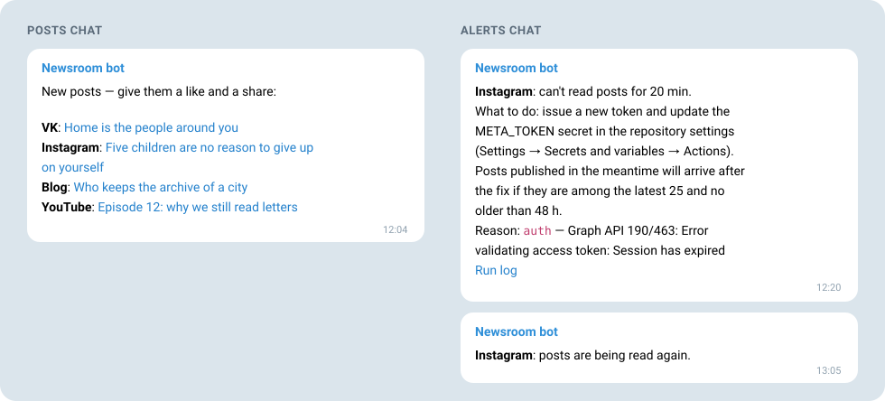

# social-notifier

**English** · [Русский](README.ru.md)

[](https://github.com/discours/social-notifier/actions/workflows/ci.yml)

**New posts from all your social networks in one Telegram message — and an alert the moment a network stops answering.**

social-notifier watches VK, Instagram, Facebook, YouTube, X, Bluesky and any RSS or Atom feed. Posts published within ten minutes of each other arrive as one message, so your team can like and share them while they are fresh. When a token expires or a network stops answering, the person in charge hears about it from the bot: which network, for how long, what to do and why.

It runs on GitHub Actions in your own repository. There is no server to maintain and no subscription to pay: Actions minutes are free for public repositories.



## Why it exists

The [Discours](https://discours.io) newsroom used to send these notifications through a no-code automation service. When its Meta token expired, the service kept marking every run as successful, and Instagram and Facebook posts stopped reaching the team for three months without a single warning.

social-notifier treats silence as a failure. A source that fails two runs in a row produces an alert, and once it answers again the bot says so.

## What you get

- **One message for every network.** Posts published within the grouping window (10 minutes by default) arrive together, in publication order, each as a link with its first line. A message with a single post shows a link preview.
- **Alerts instead of silence.** The alert names the network, how long it has been failing, the exact secret or setting to fix and the reason, with a link to the run log. After the fix comes “posts are being read again”. A source that keeps failing is reminded about once a day, not every ten minutes.
- **Posts survive outages.** A post leaves the queue only after Telegram has accepted the message. Posts published while a network was down are picked up after the fix — up to `fetchLimit` per source, up to `maxPostAgeHours` old.
- **No archive dumps.** The first run, and the first poll of every new source, remember the posts already published and send nothing. Your chat only ever sees new posts.
- **Eight networks, one config file.** VK, Instagram, Facebook, YouTube, X, Bluesky, Telegram channels and RSS/Atom, which covers Mastodon, Substack, blogs and podcasts.
- **English or Russian.** One field, `"language": "en"` or `"ru"`, switches messages, alerts and logs.
- **A probe that sets you up.** One workflow reads every source with your tokens, shows which pages the Meta token can see, finds your chat IDs — the bot replies with the ID right in each chat — and sends a sample notification built from your latest posts.
- **Safe in a public repository.** Tokens never reach logs, alerts or saved state; the public log holds counters, IDs and dates. Every action is pinned by SHA.
- **Nothing to host.** GitHub Actions runs it on schedule; Node.js runs the TypeScript directly, with zero runtime dependencies.

## Networks

| Network | `type` | What you need | Cost |
| --- | --- | --- | --- |
| [VK](docs/sources/vk.md) | `vk` | a VK ID app service key | free |
| [Instagram](docs/sources/meta.md) | `instagram` | a Meta system user token | free |
| [Facebook](docs/sources/meta.md) | `facebook` | the same Meta token | free |
| [Bluesky](docs/sources/bluesky.md) | `bluesky` | nothing for a public profile | free |
| [YouTube](docs/sources/youtube.md) | `youtube` | a YouTube Data API key | free within the quota |
| [X](docs/sources/x.md) | `x` | an X API app token and credits | $0.005 per post read: cents a month for one account |
| [RSS and Atom](docs/sources/feed.md) | `feed` | the feed URL | free: Mastodon, Substack, blogs, podcasts |
| [Telegram channels](docs/sources/telegram.md) | `telegram` | nothing for a public channel | free |

TikTok, Threads, LinkedIn and Dzen are not supported yet — [what stands in the way for each](docs/sources/unsupported.md).

## Quick start

Your first message, from an RSS feed, Bluesky and YouTube. Commands use the [GitHub CLI](https://cli.github.com/); `OWNER/REPO` is your repository, and `gh secret set` asks for the value without showing it.

1. **Copy the repository.** Fork it with **Copy the main branch only** checked, or click **Use this template**. Keep it public. In a fork, enable workflows on the **Actions** tab.
2. **Create a bot.** Send `/newbot` to [@BotFather](https://t.me/BotFather) and save the token:

   ```bash
   gh secret set TELEGRAM_BOT_TOKEN --repo OWNER/REPO
   ```

3. **List your sources.** In the `main` branch of your copy create `config/newsroom.json` (on GitHub: **Add file → Create new file**) with your own accounts — each network's page says what to put there:

   ```json
   {
     "language": "en",
     "messageTitle": "New posts — give them a like and a share:",
     "groupWindowMinutes": 10,
     "maxPostAgeHours": 48,
     "fetchLimit": 25,
     "sources": [
       { "id": "blog", "type": "feed", "label": "Blog", "url": "https://example.com/feed.xml" },
       { "id": "bluesky", "type": "bluesky", "label": "Bluesky", "handle": "example.bsky.social" },
       { "id": "youtube", "type": "youtube", "label": "YouTube", "channelId": "UCxxxxxxxxxxxxxxxxxxxxxx" }
     ]
   }
   ```

   Point the workflows at it and add the [YouTube key](docs/sources/youtube.md):

   ```bash
   gh variable set RADAR_CONFIG --body config/newsroom.json --repo OWNER/REPO
   gh secret set YOUTUBE_API_KEY --repo OWNER/REPO
   ```

4. **Find your chat IDs.** Add the bot to the group where posts should go (to a channel — as an admin allowed to post), and send `/start` to the bot in a private chat for alerts. Then run:

   ```bash
   gh workflow run probe.yml -f find_chats=true --repo OWNER/REPO
   ```

   The bot replies in each chat with its ID. Save them:

   ```bash
   gh secret set TELEGRAM_CHAT_ID --repo OWNER/REPO
   gh secret set TELEGRAM_ALERT_CHAT_ID --repo OWNER/REPO
   ```

5. **See a sample.** The probe checks every source and the bot, and sends a sample notification with the latest post of each source to the alerts chat:

   ```bash
   gh workflow run probe.yml -f send_test=true --repo OWNER/REPO
   ```

6. **Start.** The first run remembers the current posts and sends nothing; then turn on the schedule:

   ```bash
   gh workflow run radar.yml --repo OWNER/REPO
   gh variable set RADAR_ENABLED --body true --repo OWNER/REPO
   ```

From now on every new post reaches your chat. Instagram, Facebook, VK and X, forks and troubleshooting are covered in the [setup guide](docs/setup.md).

## How it works

- Every 10 minutes the [`radar`](.github/workflows/radar.yml) workflow reads the latest posts of each source.
- A new post joins the queue. Once the grouping window (`groupWindowMinutes`) has passed since the earliest queued post was published, the whole queue goes out as one message, in publication order.
- Posts published before the radar started watching a source are remembered silently, even when the radar sees them for the first time. So neither the first poll, nor a new source, nor a higher `fetchLimit` sends an archive. Watching starts with the first poll attempt: if a source failed from the very beginning, posts published after that attempt arrive once it works.
- A post the radar first sees when it is already older than `maxPostAgeHours` is not sent. A post already in the queue goes out even if Telegram was unavailable for longer.
- State — seen posts, the queue, failure counters — lives in the `state` branch, apart from the code.
- When a source fails two runs in a row, the alerts chat gets a message: which network, for how long, what to do and the reason. A response the radar could only partly parse counts as a failure too. After the fix comes “posts are being read again”.
- An alert and a red run per source happen at most once a day, even when a source fails every other run. One exception: if an alert said a response was only partly parsed and the source then fails completely, a new alert comes at once. GitHub emails about a red scheduled run to whoever last changed the schedule in the workflow or re-enabled it; make sure Actions emails are on: GitHub → Settings → Notifications → Actions.

Internally the polling is called the radar: workflow `radar`, config `radar.config.json`, variable `RADAR_ENABLED`. Until 08.11.2026 the repository was called `social-radar`; GitHub redirects the old links here.

## Configuration

The config is [`radar.config.json`](radar.config.json) or the file named in the `RADAR_CONFIG` repository variable:

```json
{
  "language": "en",
  "messageTitle": "New posts — give them a like and a share:",
  "groupWindowMinutes": 10,
  "maxPostAgeHours": 48,
  "fetchLimit": 25,
  "sources": [
    { "id": "vk", "type": "vk", "label": "VK", "ownerId": -89236419 },
    { "id": "bluesky", "type": "bluesky", "label": "Bluesky", "handle": "example.bsky.social" }
  ]
}
```

| Field | What it sets |
| --- | --- |
| `language` | language of messages, alerts and logs: `en` or `ru`; optional, `en` by default |
| `messageTitle` | first line of the message, up to 256 characters |
| `groupWindowMinutes` | grouping window, 0–120 minutes |
| `maxPostAgeHours` | posts older than this are not sent, 1–720 hours |
| `fetchLimit` | how many latest posts to read from each network per run, 1–100; YouTube returns at most 50, X at least 5 |
| `sources` | sources: `id` (Latin letters, the key in the state), `type` (network), `label` (name in the message) and the network's own fields, described on its page |
| `graphApiVersion`, `vkApiVersion` | optional: Meta and VK API versions, `v25.0` and `5.199` by default |

Repository secrets:

| Secret | Purpose |
| --- | --- |
| `TELEGRAM_BOT_TOKEN` | bot token from @BotFather |
| `TELEGRAM_CHAT_ID` | chat that receives posts |
| `TELEGRAM_ALERT_CHAT_ID` | chat for alerts; without it alerts go to the posts chat |
| `VK_TOKEN` | VK |
| `META_TOKEN` | Instagram and Facebook |
| `YOUTUBE_API_KEY` | YouTube |
| `X_BEARER_TOKEN` | X |

Repository variables: `RADAR_ENABLED=true` turns on the schedule (without it only manual runs work), `RADAR_CONFIG` is the config path if it is not `radar.config.json`.

## Running locally

Node.js 22.18 or newer runs the TypeScript directly, without a build step. There are no runtime dependencies, only development tools.

```bash
npm ci
npm run typecheck && npm test
```

A dry run sends nothing to Telegram and saves no state. Secrets come from environment variables with the same names:

```bash
node src/main.ts --dry-run --state state/state.json
```

The access probe shows what each token can see:

```bash
node src/probe.ts
```

Both commands read `radar.config.json`. Pass your own config with `--config config/newsroom.json`.

## Security

- Logs of a public repository are visible to everyone. Secrets never reach the log, alerts or state: known values and anything that looks like a token are scrubbed from every text before output. A normal run logs counters, IDs and dates; a dry run also shows post texts, and the probe shows names of pages and accounts the Meta token can see. That is public content.
- Network tokens travel in a header or the request body, never in the URL. The Telegram Bot API accepts its token only in the URL path; the radar never prints that URL.
- Workflows with secrets run only on schedule and by hand. A pull request from a fork gets no secrets: CI runs with read-only permissions.
- Secrets kept in the `production` environment reach only jobs started from `main`. A copy left in the repository secrets can be read from any branch: a workflow changed there simply drops the `environment` key. How to set it up — [setup](docs/setup.md#0-your-own-copy).
- Actions are pinned by SHA; Dependabot proposes updates monthly.

Found a vulnerability? Report it privately as described in [SECURITY.md](SECURITY.md).

## Contributing

How to propose a change or add a network: [CONTRIBUTING.md](CONTRIBUTING.md) and [docs/adding-a-source.md](docs/adding-a-source.md).

## License

[MIT](LICENSE)
