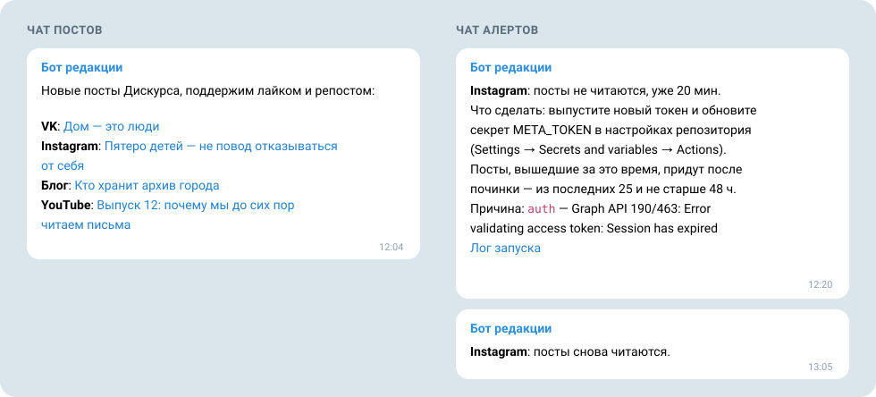

# social-notifier

[English](README.md) · **Русский**

[](https://github.com/discours/social-notifier/actions/workflows/ci.yml)

**Новые посты всех ваших соцсетей — одним сообщением в Telegram. А если сеть перестала отвечать — алерт сразу, а не тишина.**

social-notifier следит за VK, Instagram, Facebook, YouTube, X, Bluesky и любой лентой RSS или Atom. Посты, вышедшие в пределах десяти минут, приходят одним сообщением, и команда успевает поддержать их лайком и репостом, пока они свежие. Когда токен истёк или сеть замолчала, ответственный узнаёт об этом от бота: какая сеть, как давно, что сделать и почему.

Сервис работает на GitHub Actions в вашем собственном репозитории. Не нужен ни сервер, ни подписка: для публичного репозитория минуты Actions бесплатны.



## Зачем он появился

Редакция [«Дискурса»](https://discours.io) раньше рассылала такие уведомления через сервис автоматизации без кода. Когда токен Meta истёк, сервис продолжал отмечать каждый запуск успешным, и посты Instagram и Facebook три месяца не доходили до команды — без единого предупреждения.

social-notifier считает тишину сбоем. Если источник не ответил два запуска подряд, приходит алерт, а когда он снова заработает, бот сообщит и об этом.

## Что вы получаете

- **Одно сообщение на все сети.** Посты, вышедшие в пределах окна группировки (по умолчанию 10 минут), приходят вместе, по порядку публикации, каждый — ссылкой с первой строкой текста. Сообщение с одним постом показывает превью ссылки.
- **Алерт вместо тишины.** Алерт называет сеть, давность сбоя, точный секрет или настройку, которые надо поправить, и причину, а ещё даёт ссылку на лог запуска. После починки приходит «посты снова читаются». Если источник продолжает сбоить, напоминание приходит раз в сутки, а не каждые десять минут.
- **Посты переживают сбои.** Пост снимается с очереди только после того, как Telegram принял сообщение. Посты, вышедшие, пока сеть не отвечала, подхватываются после починки — до `fetchLimit` на источник и не старше `maxPostAgeHours`.
- **Без архива в чате.** Первый запуск и первый опрос каждого нового источника молча запоминают уже вышедшие посты. В чат приходят только новые.
- **Семь сетей, один конфиг.** VK, Instagram, Facebook, YouTube, X, Bluesky и RSS/Atom — а через них Mastodon, Substack, блоги и подкасты.
- **По-русски или по-английски.** Одно поле, `"language": "ru"` или `"en"`, переключает сообщения, алерты и логи.
- **Проба, которая настраивает.** Один workflow читает каждый источник вашими токенами, показывает, какие страницы видит токен Meta, находит ID ваших чатов — бот отвечает ID прямо в каждом чате — и присылает образец уведомления из ваших последних постов.
- **Безопасно в публичном репозитории.** Токены не попадают ни в логи, ни в алерты, ни в сохранённое состояние; в публичном логе — счётчики, ID и даты. Все экшены закреплены по SHA.
- **Нечего держать у себя.** По расписанию его запускает GitHub Actions; Node.js исполняет TypeScript напрямую, зависимостей во время работы нет.

## Какие сети

| Сеть | `type` | Что нужно | Цена |
| --- | --- | --- | --- |
| [VK](docs/sources/vk.ru.md) | `vk` | сервисный ключ приложения VK ID | бесплатно |
| [Instagram](docs/sources/meta.ru.md) | `instagram` | токен системного пользователя Meta | бесплатно |
| [Facebook](docs/sources/meta.ru.md) | `facebook` | тот же токен Meta | бесплатно |
| [Bluesky](docs/sources/bluesky.ru.md) | `bluesky` | ничего, если профиль открыт | бесплатно |
| [YouTube](docs/sources/youtube.ru.md) | `youtube` | ключ YouTube Data API | бесплатно в пределах квоты |
| [X](docs/sources/x.ru.md) | `x` | токен приложения X API и кредиты | $0,005 за прочитанный пост: для одного аккаунта — центы в месяц |
| [RSS и Atom](docs/sources/feed.ru.md) | `feed` | адрес ленты | бесплатно: Mastodon, Substack, блоги, подкасты |

TikTok, Threads, Telegram-каналы, LinkedIn и Дзен пока не поддерживаются — [что мешает каждой сети](docs/sources/unsupported.ru.md).

## Быстрый старт

Первое сообщение — из ленты RSS, Bluesky и YouTube. Команды используют [GitHub CLI](https://cli.github.com/); `OWNER/REPO` — ваш репозиторий, а `gh secret set` спрашивает значение сам и не показывает его на экране.

1. **Скопируйте репозиторий.** Сделайте форк с отметкой **Copy the main branch only** или нажмите **Use this template**. Оставьте копию публичной. В форке включите workflow на вкладке **Actions**.
2. **Создайте бота.** Отправьте `/newbot` боту [@BotFather](https://t.me/BotFather) и сохраните токен:

   ```bash
   gh secret set TELEGRAM_BOT_TOKEN --repo OWNER/REPO
   ```

3. **Перечислите источники.** В ветке `main` своей копии создайте `config/newsroom.json` (на GitHub: **Add file → Create new file**) со своими аккаунтами — что вписать для каждой сети, сказано на её странице:

   ```json
   {
     "language": "ru",
     "messageTitle": "Новые посты, поддержим лайком и репостом:",
     "groupWindowMinutes": 10,
     "maxPostAgeHours": 48,
     "fetchLimit": 25,
     "sources": [
       { "id": "blog", "type": "feed", "label": "Блог", "url": "https://example.com/feed.xml" },
       { "id": "bluesky", "type": "bluesky", "label": "Bluesky", "handle": "example.bsky.social" },
       { "id": "youtube", "type": "youtube", "label": "YouTube", "channelId": "UCxxxxxxxxxxxxxxxxxxxxxx" }
     ]
   }
   ```

   Укажите путь к нему и добавьте [ключ YouTube](docs/sources/youtube.ru.md):

   ```bash
   gh variable set RADAR_CONFIG --body config/newsroom.json --repo OWNER/REPO
   gh secret set YOUTUBE_API_KEY --repo OWNER/REPO
   ```

4. **Узнайте ID чатов.** Добавьте бота в группу, куда должны приходить посты (в канал — администратором с правом публиковать), и напишите боту `/start` в личку — туда пойдут алерты. Затем запустите:

   ```bash
   gh workflow run probe.yml -f find_chats=true --repo OWNER/REPO
   ```

   Бот ответит в каждом чате его ID. Сохраните их:

   ```bash
   gh secret set TELEGRAM_CHAT_ID --repo OWNER/REPO
   gh secret set TELEGRAM_ALERT_CHAT_ID --repo OWNER/REPO
   ```

5. **Посмотрите образец.** Проба проверит каждый источник и бота и пришлёт в чат алертов образец уведомления — по последнему посту каждого источника:

   ```bash
   gh workflow run probe.yml -f send_test=true --repo OWNER/REPO
   ```

6. **Запустите.** Первый запуск запомнит текущие посты и ничего не пришлёт; затем включите расписание:

   ```bash
   gh workflow run radar.yml --repo OWNER/REPO
   gh variable set RADAR_ENABLED --body true --repo OWNER/REPO
   ```

Теперь каждый новый пост приходит в ваш чат. Instagram, Facebook, VK и X, форки и разбор сбоев — в [инструкции по настройке](docs/setup.ru.md).

## Как это работает

- Раз в 10 минут workflow [`radar`](.github/workflows/radar.yml) читает последние посты каждого источника.
- Новый пост встаёт в очередь. Когда с публикации самого раннего поста в очереди проходит окно группировки (`groupWindowMinutes`), вся очередь уходит одним сообщением, по порядку публикации.
- Посты, вышедшие до начала наблюдения за источником, радар запоминает молча, даже если видит их впервые. Поэтому ни первый опрос, ни новый источник, ни подъём `fetchLimit` не присылают архив. Начало наблюдения — первая попытка опроса: если источник не отвечал с самого начала, посты, вышедшие после неё, придут, когда он заработает.
- Пост, который радар впервые увидел уже старше `maxPostAgeHours`, не присылается. Пост, уже стоящий в очереди, уйдёт, даже если Telegram был недоступен дольше.
- Состояние — виденные посты, очередь, счётчики сбоев — лежит в ветке `state`, отдельно от кода.
- Источник не ответил два запуска подряд — в чат алертов приходит сообщение: какая сеть, как давно, что сделать и причина. Ответ, часть которого радар не смог разобрать, тоже считается сбоем. После починки приходит «посты снова читаются».
- Алерт и красный запуск по одному источнику — не чаще раза в сутки, даже если источник сбоит через раз. Одно исключение: если алерт сообщал, что ответ разобрался не целиком, а потом источник отказал полностью, новый алерт придёт сразу. О красном запуске по расписанию GitHub пишет на почту тому, кто последним менял расписание в workflow или включал workflow заново. Проверьте, что письма Actions у вас включены: GitHub → Settings → Notifications → Actions.

Внутри опрос называется «радар»: workflow `radar`, конфиг `radar.config.json`, переменная `RADAR_ENABLED`. До 08.11.2026 репозиторий назывался `social-radar`; старые ссылки GitHub перенаправляет сюда.

## Настройки

Конфиг — [`radar.config.json`](radar.config.json) или файл из переменной репозитория `RADAR_CONFIG`:

```json
{
  "language": "ru",
  "messageTitle": "Новые посты, поддержим лайком и репостом:",
  "groupWindowMinutes": 10,
  "maxPostAgeHours": 48,
  "fetchLimit": 25,
  "sources": [
    { "id": "vk", "type": "vk", "label": "VK", "ownerId": -89236419 },
    { "id": "bluesky", "type": "bluesky", "label": "Bluesky", "handle": "example.bsky.social" }
  ]
}
```

| Поле | Что задаёт |
| --- | --- |
| `language` | язык сообщений, алертов и логов: `ru` или `en`; необязательно, по умолчанию `en` |
| `messageTitle` | первая строка сообщения, до 256 символов |
| `groupWindowMinutes` | окно группировки, 0–120 минут |
| `maxPostAgeHours` | посты старше этого не присылаются, 1–720 часов |
| `fetchLimit` | сколько последних постов читать у каждой сети за раз, 1–100; YouTube отдаёт не больше 50, X — не меньше 5 |
| `sources` | источники: `id` (латиница, ключ в состоянии), `type` (сеть), `label` (подпись в сообщении) и поля сети — на её странице |
| `graphApiVersion`, `vkApiVersion` | необязательно: версии API Meta и VK, по умолчанию `v25.0` и `5.199` |

Секреты репозитория:

| Секрет | Зачем |
| --- | --- |
| `TELEGRAM_BOT_TOKEN` | токен бота от @BotFather |
| `TELEGRAM_CHAT_ID` | чат, куда приходят посты |
| `TELEGRAM_ALERT_CHAT_ID` | чат для алертов; без него алерты идут в чат постов |
| `VK_TOKEN` | VK |
| `META_TOKEN` | Instagram и Facebook |
| `YOUTUBE_API_KEY` | YouTube |
| `X_BEARER_TOKEN` | X |

Переменные репозитория: `RADAR_ENABLED=true` включает расписание (без неё работает только ручной запуск), `RADAR_CONFIG` — путь к конфигу, если он не `radar.config.json`.

## Локальный запуск

Нужен Node.js 22.18 или новее: TypeScript исполняется напрямую, без сборки. Зависимостей во время работы нет, только инструменты разработки.

```bash
npm ci
npm run typecheck && npm test
```

Пробный запуск — без отправки в Telegram и без записи состояния. Секреты берутся из переменных окружения с теми же именами:

```bash
node src/main.ts --dry-run --state state/state.json
```

Проба доступов — что видит каждый токен:

```bash
node src/probe.ts
```

Обе команды читают `radar.config.json`. Свой конфиг передайте флагом: `--config config/newsroom.json`.

## Безопасность

- Логи публичного репозитория видны всем. Секреты в лог, алерты и состояние не попадают: известные значения и всё, похожее на токен, вычищается из любого текста перед выводом. Обычный запуск пишет счётчики, ID и даты; пробный запуск показывает ещё тексты постов, а проба — названия страниц и аккаунтов, которые видит токен Meta. Это публичный контент.
- Токены сетей передаются в заголовке или теле запроса, не в адресе. Токен Telegram Bot API принимает только в пути адреса; этот адрес радар не печатает нигде.
- Workflow с секретами запускаются только по расписанию и вручную. Pull request из форка секретов не получает: CI работает с правом только на чтение.
- Экшены закреплены по SHA, Dependabot предлагает обновления раз в месяц.

Нашли уязвимость — сообщите приватно, как написано в [SECURITY.ru.md](SECURITY.ru.md).

## Участие

Как предложить правку и добавить новую сеть — в [CONTRIBUTING.ru.md](CONTRIBUTING.ru.md) и [docs/adding-a-source.ru.md](docs/adding-a-source.ru.md).

## Лицензия

[MIT](LICENSE)
